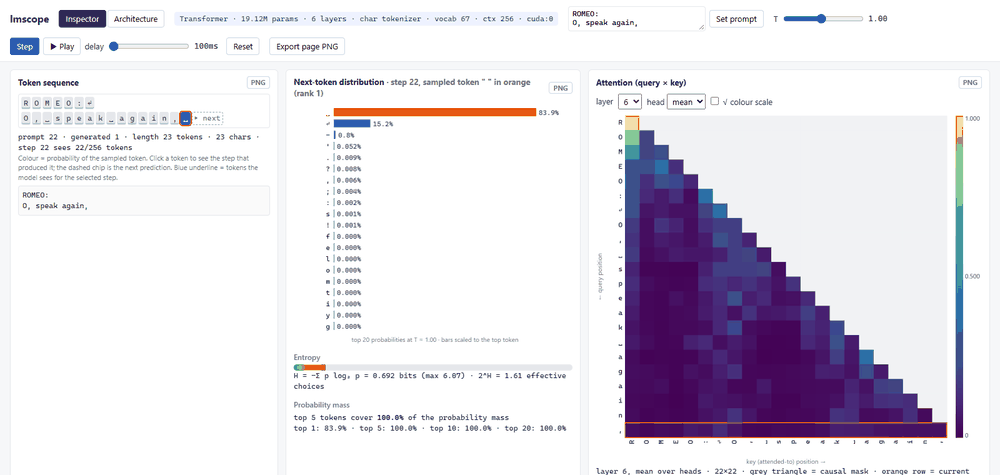
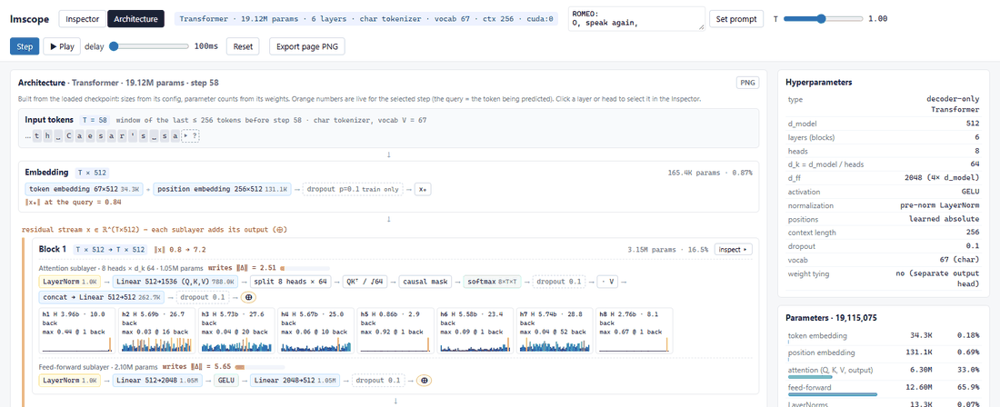
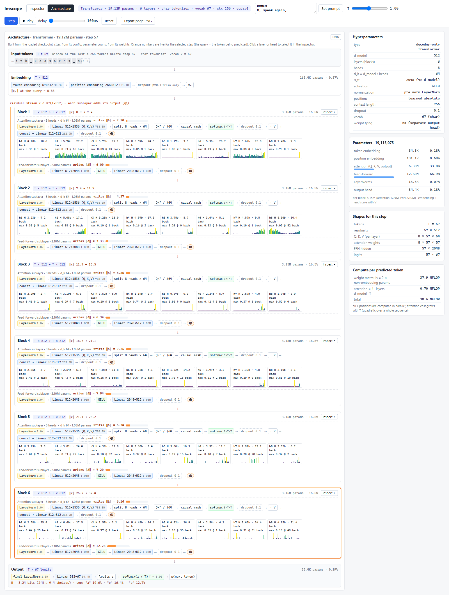
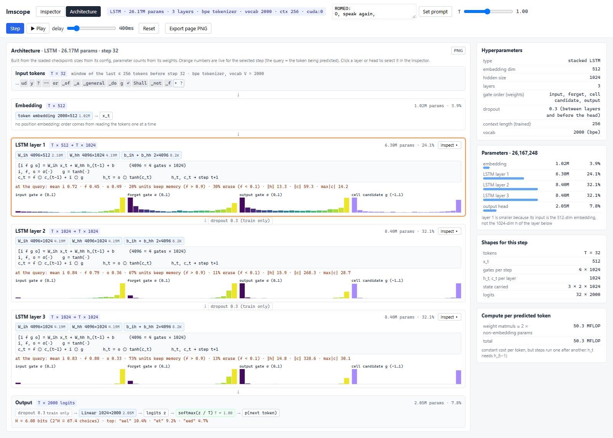
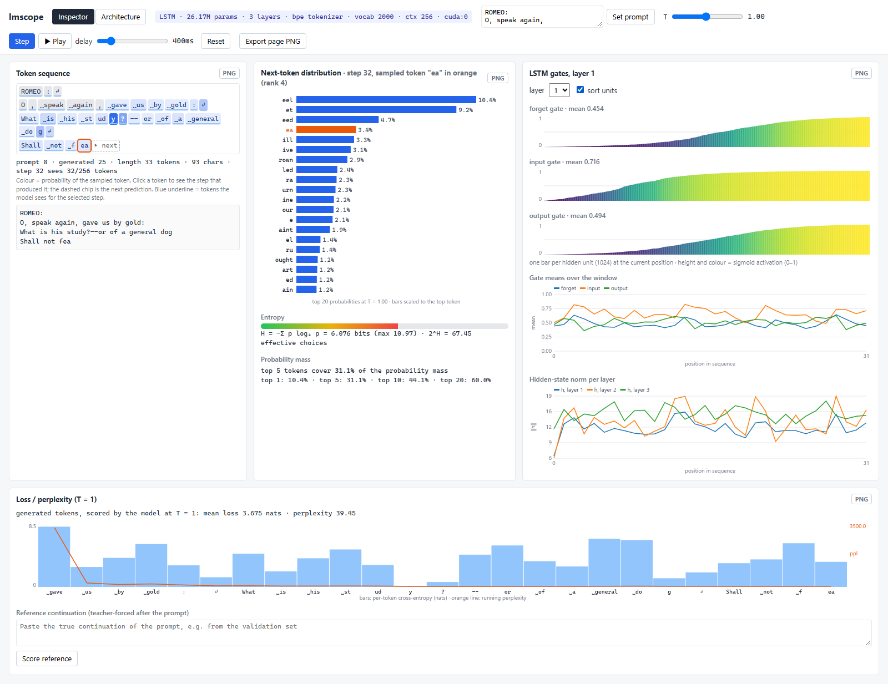
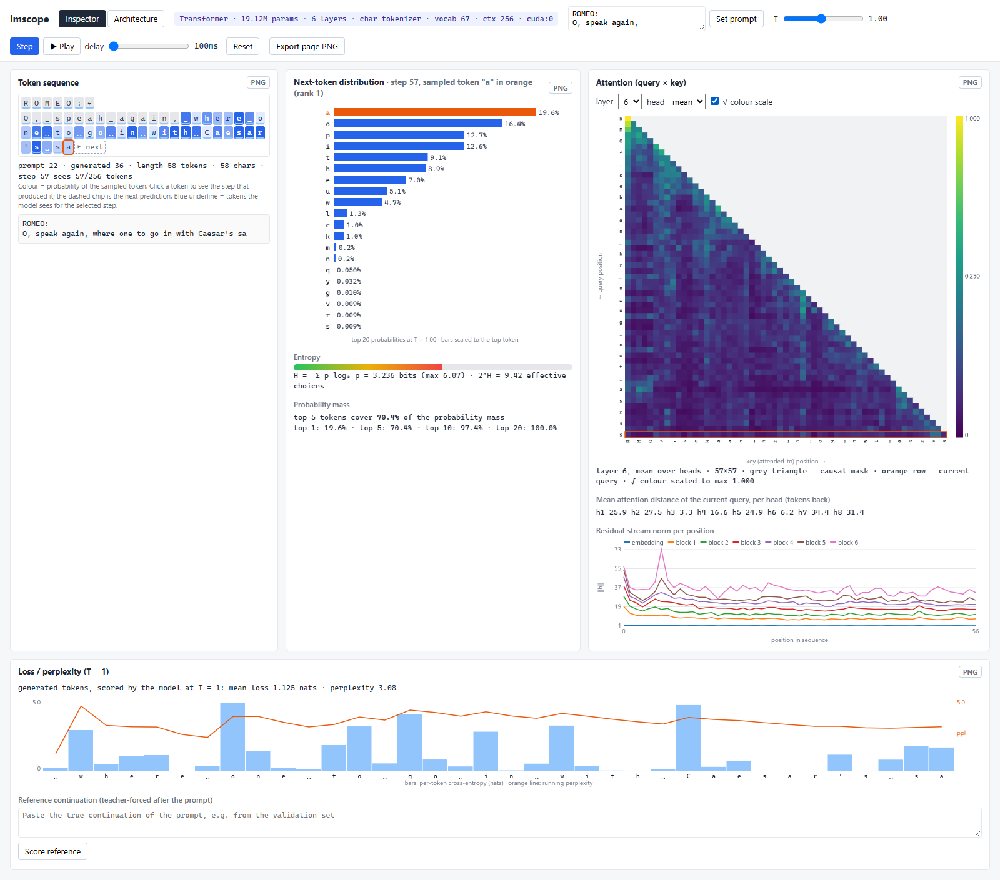

# lmscope

**Watch a small language model think, one token at a time.**

lmscope is a learning and visualization tool for small character- or BPE-level language models
(LSTM and decoder-only Transformer). Load a checkpoint, give it a prompt, and step through generation
in the browser. At every step you see:

- the probability distribution over the next token;
- the attention maps of every layer and head (Transformer), or the gate values of every unit (LSTM);
- the loss and perplexity of what the model generated;
- a live diagram of the architecture itself.

It is meant for people learning how these models work, for course projects, and for making figures
for reports. It is not a training framework or a serving stack. It works on one sequence at a time,
so every number on screen comes from a single forward pass you can follow.



## What you can look at

| | Transformer | LSTM |
|---|---|---|
| Next-token distribution | top-k bars, entropy (bits), effective number of choices, top-k probability mass | same |
| Inside the model | query × key attention heatmap per layer and head (or the mean over heads), √ colour scale to see weak attention next to a sink, mean attention distance per head | input / forget / output gate value of every hidden unit, gate means over time |
| Over the sequence | residual-stream norm after the embedding and after every block | hidden-state norm per layer |
| Loss | per-token cross-entropy and running perplexity of the generated text, or of a reference continuation you paste in (with bits per character) | same |
| Architecture tab | every block drawn from the loaded weights, with parameter counts and tensor shapes; live per-head attention entropy, distance and sparklines; how much each sublayer writes into the residual stream | every layer with its weight shapes and equations; live gate histograms; share of units keeping or erasing memory; ‖h‖ and ‖c‖ |

Click any earlier token to replay the step that produced it. Click a layer or head in the
Architecture tab to open it in the Inspector. Every panel has a PNG export button for reports.

### Architecture tab

The diagram is built from the checkpoint, not drawn by hand: sizes come from the config and
parameter counts from the weights. The orange numbers update with the selected step.



<details>
<summary>Full-page screenshots (Transformer and LSTM)</summary>









</details>

## Install

```bash
pip install lmscope
```

Needs Python 3.9 or newer and depends on `torch`, `flask` and `tokenizers`. If you want CUDA,
install the PyTorch build for your GPU first; lmscope also runs on the CPU.

## Use

```bash
# character-level Transformer (tokenizer stored in the checkpoint)
lmscope serve --model transformer_char_best.pt

# BPE LSTM with an external HuggingFace tokenizer file
lmscope serve --model lstm_bpe2000_best.pt --tokenizer bpe2000_tokenizer.json --tokenizer-type bpe
```

The browser opens at `http://127.0.0.1:8765`. Then:

1. Type a prompt (newlines are allowed) and press **Set prompt**.
2. Press **Step** to sample one token, or **Play** to keep sampling. The slider sets the delay.
3. Move **T** to change the sampling temperature and watch the distribution sharpen or flatten.
4. Pick a **layer** and **head** (Transformer) or a layer (LSTM) in the internals panel,
   or switch to the **Architecture** tab and click one there.
5. Paste the true continuation of the prompt into the reference box and press **Score reference**
   to see where the model is surprised. `--reference valid.txt` preloads it.
6. **Reset** goes back to the prompt with the same sampling seed, so a run can be reproduced.

| Option | Meaning |
|---|---|
| `--model` | checkpoint path (required) |
| `--model-type` | `transformer` or `lstm`; only checked against the checkpoint |
| `--tokenizer`, `--tokenizer-type` | tokenizer file and `char` / `bpe`, when not stored in the checkpoint |
| `--prompt` | initial prompt (default `"ROMEO:\n"`) |
| `--seed` | sampling seed, restored on Reset (default 0) |
| `--reference` | text file preloaded as the reference continuation |
| `--device` | `cuda` or `cpu` (default: CUDA if available) |
| `--port`, `--host`, `--no-browser` | server settings |

From Python:

```python
import lmscope
lmscope.serve(model_path="transformer_char_best.pt", port=8765)

# or without the browser
from lmscope import Inspector, load_checkpoint
model, tok, config = load_checkpoint("transformer_char_best.pt")
insp = Inspector(model, tok, config)
insp.set_prompt("ROMEO:\n")
insp.sample(temperature=0.8)
step = insp.analyze(layer=5, head="mean")   # distribution + attention of the last step
print(insp.architecture()["groups"])        # parameter count per component
```

## Checkpoint format

lmscope rebuilds the model from a dictionary saved with `torch.save`:

```python
{
    "model_state_dict": ...,
    "model_config": {"model_type": "transformer" | "lstm", "vocab_size": int, "d_model": int,
                     "n_layers": int, "context_len": int, "dropout": float,
                     "n_heads": int, "d_ff": int,          # Transformer
                     "hidden_size": int},                  # LSTM
    "tokenizer_type": "char" | "bpe",
    "char_to_idx": {...}, "idx_to_char": {...},            # char
    "bpe_tokenizer_json": str,                             # bpe (optional if --tokenizer is given)
}
```

The tokenizer comes from `--tokenizer` if given, otherwise from the checkpoint.

The supported models are defined in `lmscope/models.py`:

- **Transformer**: token embedding + learned position embedding, pre-norm blocks
  (`x + Attn(LN(x))`, `x + FFN(LN(x))`, GELU), final LayerNorm, linear head.
- **LSTM**: embedding, `nn.LSTM` (stacked, dropout between layers), dropout, linear head.

To use your own model, save it with the same parameter names (or copy these two classes into your
training code) in the dictionary format above.

## How it works

- **Transformer**: each attention module applies its softmax through a small `AttentionSoftmax`
  submodule. Forward hooks record the weights `(heads, T, T)` of every layer, plus what each
  attention and feed-forward sublayer adds to the residual stream.
- **LSTM**: `CustomLSTMCell` re-runs each `nn.LSTM` layer step by step from its weights
  (gate order input, forget, cell, output) and exposes the gates and the states. Its output matches
  `nn.LSTM` to about 1e-6.
- The server keeps one sequence and answers a small JSON API. The page is a single HTML file that
  draws on canvases and needs no build step.

| Endpoint | Body | Returns |
|---|---|---|
| `GET /api/model-info` | | model type, parameter count, layers, vocab size, context length |
| `GET /api/architecture` | | hyperparameters, parameter counts per module and per component group, FLOPs per token |
| `GET /api/state` | | token sequence with per-token sampling probability and loss |
| `POST /api/set-prompt` | `{prompt}` | tokenized prompt (resets the sequence) |
| `POST /api/reset` | | back to the prompt; sampling seed restored |
| `POST /api/step` | `{position, temperature, layer, head, top_k}` | one forward pass: distribution, internals of the selected layer, per-layer stats of all layers |
| `POST /api/sample` | `{temperature}` | samples and appends the next token |
| `POST /api/score` | `{text}` | per-token cross-entropy and running perplexity of a reference continuation |

`position` p is the prediction of token p from the tokens before it (default: the next token).

"Export page PNG" loads html2canvas from cdnjs, so it needs internet access. Offline, the
per-panel PNG buttons fall back to saving the panel's canvases.

## Releasing

The version lives in `lmscope/__init__.py` (`__version__`).

1. Bump `__version__`, commit and push.
2. Create a GitHub release with tag `vX.Y.Z`. The `Publish to PyPI` workflow builds the sdist and wheel,
   runs `twine check`, and uploads with PyPI trusted publishing (no API token in the repo).

Local build check: `python -m build && python -m twine check dist/*`.

## License

MIT
